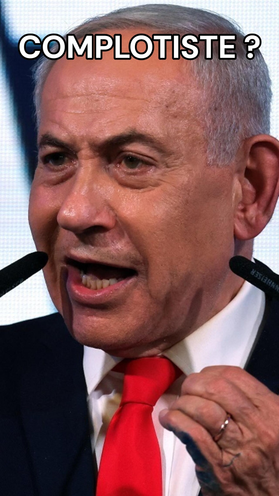

En difficulté après les dernières élections israéliennes, le premier ministre Benjamin Netanayou a utilisé une stratégie rhétorique : l'accusation d'ingérence étrangère

En bref : une théorie complotiste. Qui relie notamment de supposées implications du Qatar et de la Turquie et la poussée des votes arabes.

Les preuves publiques d'une telle ingérence sont aujourd'hui extrêmement faibles, et les autorités israéliennes ont pris posture ferme face à ces accusations, même si le Shin Bet (le renseignement intérieur israélien) enquête sur de possibles financements étrangers.

Ce genre d'accusation est désormais très courant parmi lorsque des personnalités de droite et d'extrême droite perdent une élection. Il s'agit alors soit d'une accusation contre le système en place, comme Trump en 2020, soit une accusation d'une influence étrangère comme l'a fait George Simion en Roumanie en 2025, accusant la France et la Moldavie.

Dans quels buts ? Nous pouvons imaginer que l'idée ici est de décrédibiliser la validité des votes arabes, et fragiliser la solidité des résultats. Le Likoud envisage d'ailleurs de contester les résultats de certains bureaux de vote dans des villes arabes israéliennes.

Le but n'est pas tant de convaincre que d'avoir un prétexte pour contester les résultats, d'offrir un "déni plausible", dans l'espoir, peut être, d'amener à de nouveaux résultats davantage en faveur du premier ministre actuel.
