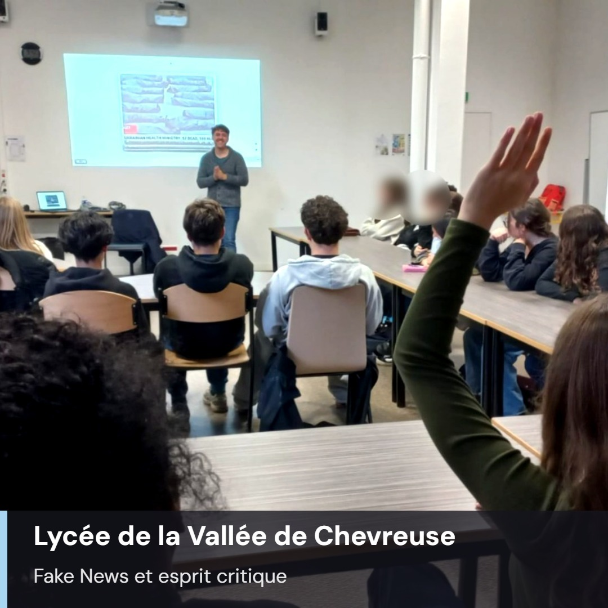

Deux superbes jours passés à Gif-sur-Yvette où nous avons pu explorer tous les aspects de l'esprit critique, des fake news, nous confronter au biais de cadrage et aux heuristiques avec des classes de secondes et de BTS !

J'étais impressionné par leur niveau, leur pertinence, leur questionnement et leur scepticisme déjà bien présent.

Merci particulièrement à Séverine pour cette organisation au cordeau et au plaisir de revenir pour de prochaines aventures critiques !

Si vous souhaitez que j'intervienne sur le sujet des Fake News dans un établissement scolaire, une entreprise ou une association, n'hésitez pas à me contacter !
