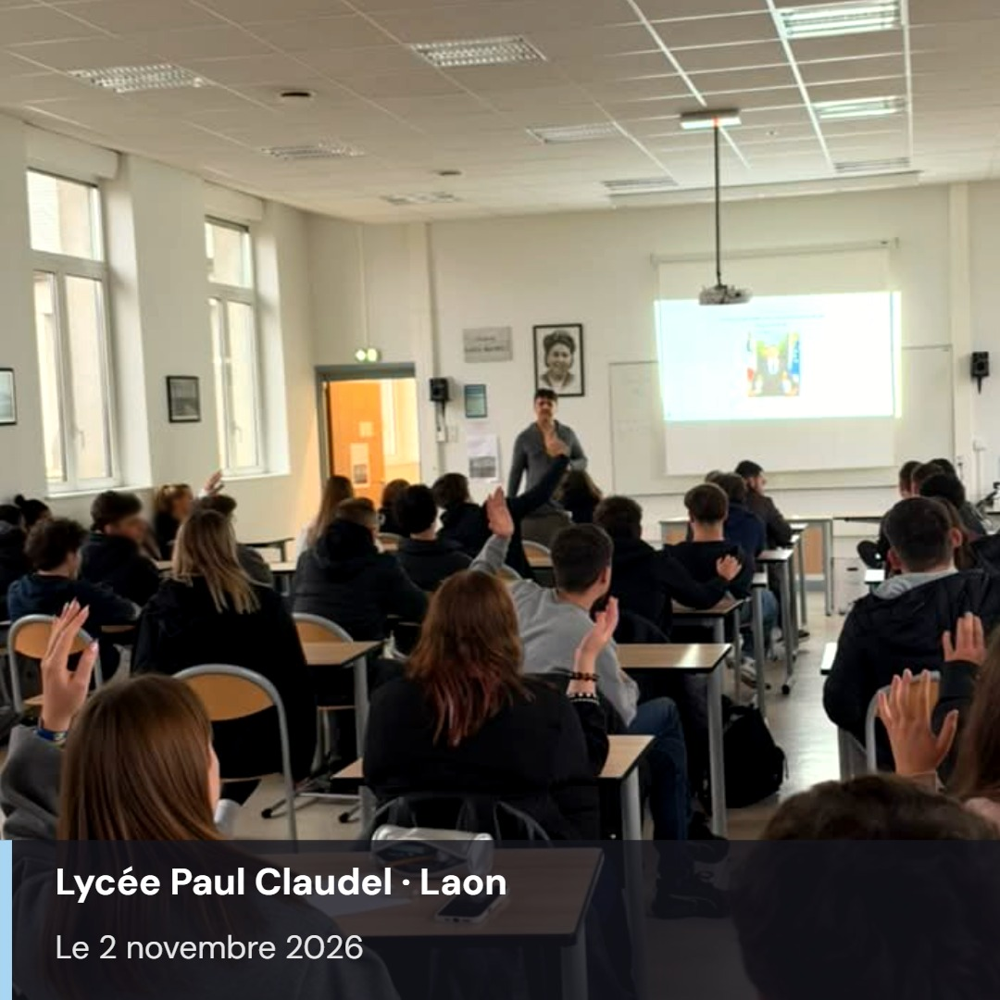

Nous avons effectué un très belle rencontre "Fake News et esprit critique au lycée Technologique Claudel de Laon !

Devant moi, deux BTS : commerce international et management.

Comme à chaque fois avec des BTS, j'ai souhaité personnaliser la rencontre pour que non seulement les élèves soient plus vigilants face à la désinformations, mais aussi que les outils proposés lors de la rencontre puissent être utile dans leur métier futur.

Nous avons vu comment les stéréotypes peuvent impacter un recrutement ou une relation avec un client étranger.

Comment les préjugés fragilisent la qualité d'un entretien.

J'espère leur avoir offert les clés pour être des citoyens vigilants face à la Fake News, mais aussi des professionnels conscients pouvant désormais faire un travail plus qualitatif et plus juste.

Au plaisir d'y revenir !

Si vous souhaitez que j'intervienne sur le sujet des Fake News dans un établissement scolaire, une entreprise ou une association, n'hésitez pas à me contacter !
