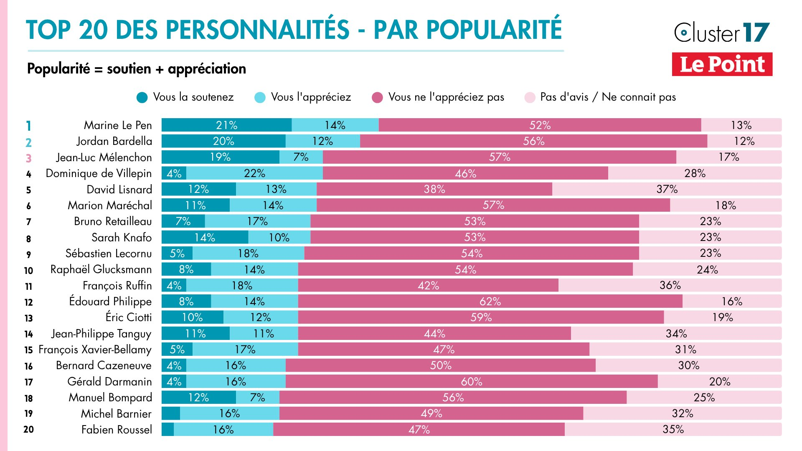

Ce sondage est incroyable.

Jean Luc Mélenchon est à la fois la troisième personnalité la plus aimée des Français et en même temps le troisième homme politique le plus détesté.

Cela montre deux choses : déjà, que la personnalité est clivante. C'est un choix assumé, notamment conditionné à un environnement médiatique qu'il estime lui être hostile - ce qui est en partie vraie.

Il a d'ailleurs confirmé cette approche lors de son dernier discours, en affirmant qu'il ne mettrait pas d'eau dans son vin.

Et cette posture est globalement payante, vu qu'il est quasiment certain d'être qualifié au second tour.

La deuxième chose, c'est que ce sondage permet d'illustrer ce qu'on appelle l'"effet de cadrage".

Pour dire simplement, c'est dire que la manière de présenter une information va impacter notre perception de cette dernière.

Par exemple, si je suis un fervent supporter de Jean-Luc Mélenchon, je vais dire : regardez ce sondage, Jean-Luc Mélenchon est la troisième personnalité préférée des Français !

Si je suis un adversaire de Jean-Luc Mélenchon, je dirais que ce sondage nous montre qu'il est le troisième homme politique le moins aimé des Français.

J'aurais raison dans tous les cas. Mais la perception de ce que je dis sera grandement différente.

N'oublions donc jamais qu'il y a toujours plusieurs manières de présenter une information et que celles-ci ne sont jamais neutres.
