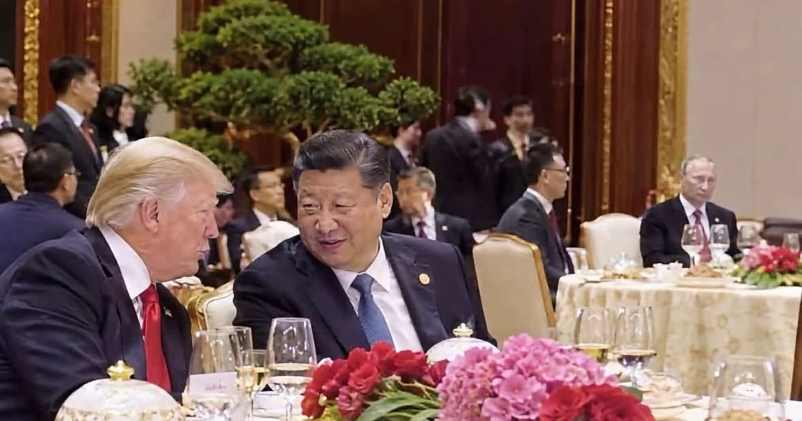

Cette photo est incroyable.

Un vrai symbole.

Non pas de l'humiliation subit par Poutine lors du sommet avec Trump et Xi.

Mais de notre facilité à tomber dans le piège de l'IA dès lors que ce que l'image nous plaît.

Car oui, cette photo, pourtant mainte fois commenté sur les réseaux, est très vraisemblablement de l'IA.

Elle n'apparaît dans aucune base de données journalistiques.

N'a été partagé par aucune source fiable.

Elle est de mauvaise qualité.

Et diplomatiquement peu crédible. Je veux bien que le président chinois considère Trump davantage comme son égal, mais vous l'imaginez vraiment mettre au coin Poutine, un allié de la Chine, à une autre table.

Alors pourquoi nous tombons dans le panneau ?

Car elle nous plait, tout simplement.

Car nous n'avons pas une immense sympathie pour Poutine, et que voir "l'homme fort de la Russie" humilié ainsi est une histoire à laquelle nous avons envie de croire.

Et donc, si une photo nous l'apporte sur un plateau, nous abolissons notre esprit critique.

N'oublions pas : si une image est trop belle pour être vraie, elle n'est le probablement pas.
