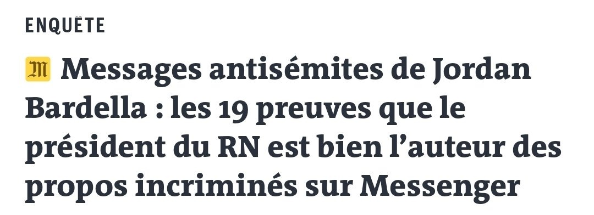

De nouvelles révélations confirment les propos antisémites de Jordan Bardela plus jeune, avec des sources qui confirment ces accusations.

Pourtant, le président du Rassemblement national continue de nier ces écrits

Pourquoi donc ?

Il y a des raisons à la fois psychologiques et stratégiques.

Bardella a déjà nié ces écrits lors des premières révélations.

S'il admet maintenant, cela veut dire soit que les premiers écrits étaient faux et que ceux-là sont vrais, soit qu'il a menti la première fois. Ce qui serait coûteux politiquement.

On se rapproche de ce que l'on appelle le biais de l'engagement.

Une fois engagé dans une démarche, il devient de plus en plus coûteux de revenir en arrière, puisque cela revient à désavouer tout ce que l'on a fait pour soi et vis à vis des autres.

La deuxième raison est de jouer sur le déni plausible.

Tant que Bardella n'avoue pas, il peut rester pour ses supporters peuvent maintenir l'idée que tout cela est faux, une erreur, un complot.

Et maintenir la défense de Bardella.

Si d'un coup Bardella admet, il n'y a plus aucune place pour ce déni et cette défense s'effondre.

D'autant que Bardella sait très bien qu'une fois avoué, ces accusations lui reviendront à chaque fois qu'il parle d'antisémitisme ou accuse un autre parti de l'être.

C'est donc cynique, mais stratégiquement, le maintien du déni de Jordan Bardella sur ses écrits est rationnellement tout à fait compréhensible.

Reste à savoir si cela tiendra sur le long terme.
